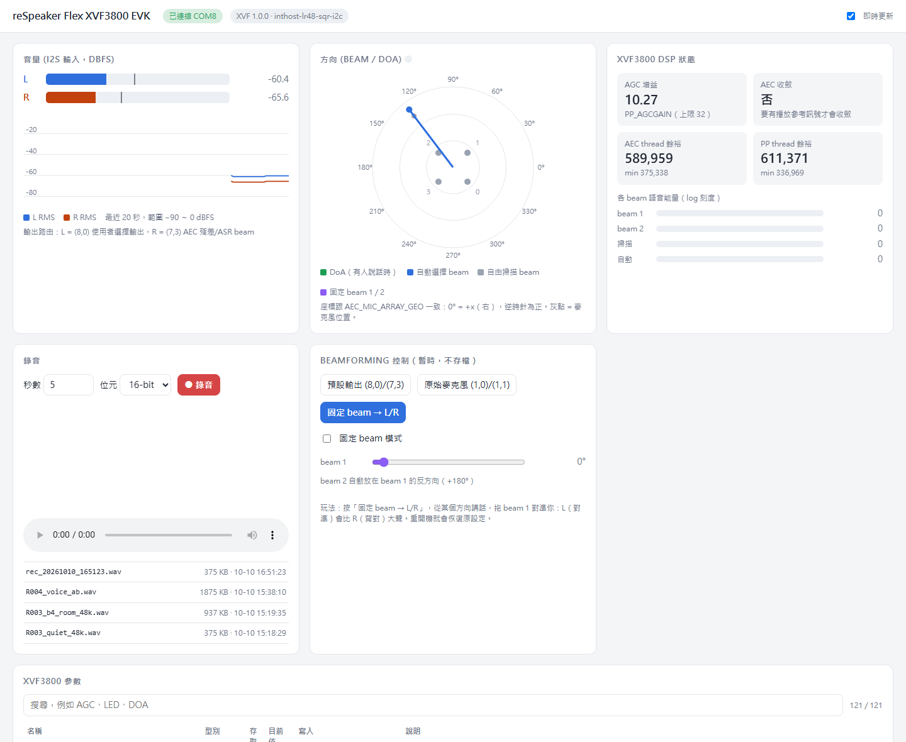
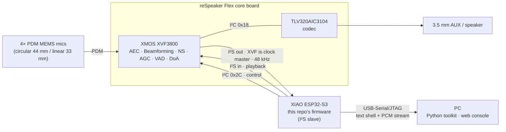

<div align="center">

# XVF3800 Mic-Array R&D — from Black Box to Own Beamformer

**Characterising a commercial voice DSP from the outside, rebuilding its signal chain from scratch, and measuring both on equal terms.**

*XMOS XVF3800 · 4-mic array · ESP32-S3 · SRP-PHAT · MVDR · multichannel Wiener filter · I2C DFU*


**English** | [繁體中文](README.zh-TW.md)



</div>

---

## At a glance

| Question | Answer, with evidence |
|---|---|
| Can a closed commercial voice DSP be understood without its source? | Yes, to a useful degree — clock role, coordinate frame and pipeline structure were inferred purely from interface measurements ([§ black-box characterisation](#1--black-box-characterisation-of-the-xvf3800)) |
| Can its localisation be reproduced from the raw microphones? | Own SRP-PHAT agrees with the chip to a **2° median** ([R006](logs/R006_srp_phat_doa_vs_xvf.md)) |
| Which beamforming design works best on this array? | Four designs implemented and compared fairly — **MVDR + Wiener (MWF)**: **+11.4 dB SNR**, STOI **0.72 → 0.80** ([R009](logs/R009_fair_eval_shadow_filtering.md)) |
| How do you know the numbers are honest? | Separate train/test spans, digital mixing with shadow filtering, and an audit showing why the naive SNR metric is gameable ([R008](logs/R008_mwf_postfilter_and_metric_limits.md)) |
| What did it take to get raw microphone data at all? | An own I2C implementation of the XMOS DFU protocol — the board has no SafeMode button and its default image exposes no USB ([R005](logs/R005_xvf_usb6ch_via_i2c_dfu.md)) |

## What this is

The [Seeed reSpeaker Flex](https://wiki.seeedstudio.com/respeaker_flex_introduction/) pairs an **XMOS XVF3800** voice processor (AEC, beamforming, noise suppression, AGC, VAD, DoA) with a **XIAO ESP32-S3** host. Out of the box it does nothing visible on a PC — the audio goes over I2S to the ESP32, and the vendor material for that path is incomplete and, on one critical point, wrong.

The work went beyond using the kit: first make it observable, then open the black box from the outside, then rebuild the signal chain from first principles and measure it against the chip. This repository contains every layer of that:

- **ESP32-S3 firmware** — a line-based control shell that drives the XVF3800 over I2C, captures its processed audio over I2S, and streams PCM to the PC loss-free.
- **Host toolkit (Python)** — name-based access to all **121 XVF3800 control parameters**, WAV recording, a scripted smoke test, DSP health monitoring and a beamforming A/B test.
- **Live web console** — levels, beam/DoA compass, DSP telemetry, one-click recording with playback, interactive beam steering and a searchable parameter editor. Zero third-party dependencies.
- **XVF3800 firmware update over I2C** — an own implementation of the XMOS DFU protocol on the ESP32, so the XVF3800 can be switched between its I2S and USB 6-channel images with no SafeMode button and no USB connection to the chip.
- **Own array processing** — SRP-PHAT localisation, delay-and-sum, MVDR and MVDR + Wiener (MWF) beamforming written from scratch on the four raw microphones, benchmarked against the XVF3800 with a leakage-free, shadow-filtering evaluation.
- **An engineering log** — every stage is a tracked experiment (`logs/R0XX`) with hypothesis, action, observation and conclusion.

## Highlights

| | |
|---|---|
| 🔍 **Root-caused a silent failure the vendor docs cause** | Following Seeed's documentation (ESP32 as I2S master) yields full-scale garbage. A purpose-built `clkprobe` command proved the XVF3800 image drives BCLK/WS itself at 48 kHz; switching the ESP32 to slave turned −6 dBFS noise into clean −48 dBFS room audio. [→ R003](logs/R003_i2s_role_xvf_is_master.md) |
| 🧠 **Own algorithms, benchmarked against XMOS** | SRP-PHAT DoA agrees with the XVF3800's own estimate to a **2° median** (84 % of frames within 10°). The best own beamformer, **MVDR + Wiener (MWF)**, raises SNR by **+11.4 dB** and STOI intelligibility from **0.72 to 0.80** under a fair shadow-filtering evaluation. [→ R006](logs/R006_srp_phat_doa_vs_xvf.md) · [R009](logs/R009_fair_eval_shadow_filtering.md) |
| 🔬 **Black-box characterisation of the XVF3800** | Probed the closed DSP through its interfaces: clock role, coordinate frame, and signal taps along the pipeline. Beam-only output gains +1.3 dB, the fully processed output +14.8 dB → most of the chip's benefit comes from post-processing after the beamformer — the same structure as our MWF. [→ R007](logs/R007_beamformer_vs_xvf.md) |
| 🔁 **Firmware swap with no button and no USB** | The board has no SafeMode button and the I2S image exposes no USB, so the XMOS I2C DFU protocol was implemented on the ESP32. A sporadic stall was traced to a 256-byte serial RX buffer and fixed; idempotent sequence numbers + checksums make every block safely resendable. 7296 blocks, 142 s, 0 retries. [→ R005](logs/R005_xvf_usb6ch_via_i2c_dfu.md) |
| 📈 **Evidence, not guesses** | Audio validity checked by spectral analysis (64 dB low/high band ratio, flatness 0.000 vs 0.56 for white noise), clock roles by edge counting, streaming integrity by exact byte accounting (`padded=0`). |
| 🧩 **Full parameter surface** | The 121-entry XVF3800 command table is parsed from the vendor tool at runtime, so CLI, GUI and scripts stay in sync with the firmware release — no hand-copied register maps. |
| 🎛️ **Live DSP visibility** | Thread headroom, gain state, per-beam speech energy, auto-select / free-running / fixed beam azimuths and DoA, refreshed several times per second. |
| 🛡️ **Reversible by design** | Full 8 MB flash backup/restore scripts, runtime-only parameter changes (never saved unless you ask), and a git history scrubbed of any recordings. |

## Capabilities

| Capability | Status |
|---|---|
| Processed audio capture to WAV — 48 kHz, stereo, 16/32-bit, loss-free (I2S image, via ESP32) | ✅ **Verified** |
| Raw 4-microphone capture — 16 kHz, plus 2 processed channels (USB 6ch image, direct to PC) | ✅ **Verified** |
| XVF3800 control — read/write all 121 parameters by name (I2C via ESP32, or USB) | ✅ **Verified** |
| XVF3800 firmware update over I2C (no SafeMode, no USB) | ✅ **Verified** |
| Live DSP telemetry — VAD, DoA, beam azimuths, thread headroom | ✅ **Verified** |
| XVF3800 beam steering — auto-select, free-running scan, fixed beams, output routing | ✅ **Verified** · live in the web console |
| Own SRP-PHAT DoA | ✅ **Verified** · 2° median vs XVF3800 |
| Own beamformers — delay-and-sum, MVDR, MVDR + Wiener (MWF) | ✅ **Verified** · MWF +11.4 dB SNR, STOI 0.72 → 0.80 (offline) |
| Web console | ✅ **Verified** |
| Real-time own processing · RTF steering · loudspeaker A/B vs XVF3800 | 🗺️ Roadmap |

> **Verified** = measured on hardware, with the numbers and method in `logs/`.

---

## Architecture



| Layer | Path | Role |
|---|---|---|
| Firmware | [`firmware/xiao_esp32s3`](firmware/xiao_esp32s3) | I2S full-duplex link (slave by default), XVF3800 I2C control with busy-retry, command shell, binary PCM streaming |
| Host library | [`host/evk`](host/evk) | Serial protocol, COM auto-detection, XVF parameter table + typed encode/decode |
| Tools | [`host/*.py`](host) | CLI, recorder, smoke test, DSP monitor, beam A/B, web console |
| Docs & evidence | [`docs/`](docs), [`logs/`](logs) | Hardware reference with sources, bring-up plan with pass criteria, experiment logs |

---

## Own array processing vs. the XVF3800

With the XVF3800 switched to its USB 6-channel image, channels 3–6 carry the four raw microphones (no gain, no delay). Everything below runs on those raw signals in [`host/algo`](host/algo), written from scratch in NumPy, and is compared with what the XMOS chip produces from the same capture.

### 1 · Black-box characterisation of the XVF3800

The DSP is closed, so its behaviour was inferred from measurements at its interfaces — not from its firmware:

| Probe | Finding |
|---|---|
| I2S edge counting with the ESP32 port disabled | XVF3800 is the **clock master** at 48 kHz (vendor docs say slave) |
| `DOA_VALUE` vs auto-select beam azimuth vs `AEC_MIC_ARRAY_GEO` | One shared frame: square array, 44.4 mm side, 0° = +x, counter-clockwise |
| Output routing taps along the pipeline (raw mics → beams → post-processed) | Beam-only output: **+1.3 dB** over a single mic; fully processed output: **+14.8 dB** → most of the gain comes from post-processing *after* spatial filtering |
| Own SRP-PHAT vs `DOA_VALUE` | Agree to **2° median** → the chip's localiser behaves like a phase-transform (PHAT-family) estimator |

Working hypothesis from these probes: *beamformer → spectral post-filter → gain control*, the classic voice front-end structure. The own pipeline below follows the same structure so each stage can be measured on its own.

### 2 · Direction of arrival — SRP-PHAT

All 6 mic pairs, PHAT-weighted cross-spectra, 1° grid, 300–3800 Hz (spatial aliasing starts at 3.86 kHz for this array).

| | Result |
|---|---|
| Synthetic plane waves, 24 directions | worst error 1° at 20 dB SNR, 4° at 0 dB |
| Live speech, 4 positions around the board | **median 2°** from the XVF3800's estimate, 84 % of frames within 10° |

The synthetic test caught a sign error (every estimate off by exactly 180°) before any hardware run — see [R006](logs/R006_srp_phat_doa_vs_xvf.md).

### 3 · Beamforming — four methods, one fair test

Talker and interferer (music) were recorded **separately** at fixed positions and summed digitally — sound adds linearly in air. Each method decides its weights and gains on the mixture only; the identical weights/gains are then applied to the speech and noise components ("shadow filtering"), giving true output SNR, speech distortion and intelligibility. Noise statistics come from a different time span than the one scored.

| Method | SNR gain | Speech SDR | STOI |
|---|---:|---:|---:|
| Single mic | 0 dB | — | 0.723 |
| Single mic + Wiener post-filter | +7.5 dB | 11.2 dB | 0.741 |
| Delay-and-sum | +0.3 dB | — | 0.740 |
| MVDR | +4.0 dB | 7.9 dB | 0.785 |
| **MVDR + Wiener (MWF)** | **+11.4 dB** | 7.1 dB | **0.797** |

*Input SNR +6.7 dB. At 0 dB input SNR the MWF gains +13.7 dB and lifts STOI from 0.56 to 0.69.* Full method and caveats: [R009](logs/R009_fair_eval_shadow_filtering.md).

**What the numbers say**

- **MWF is the best of the four** on both SNR and intelligibility.
- **Intelligibility comes mainly from spatial filtering.** The Wiener filter alone buys +7.5 dB SNR but almost no STOI; MVDR buys only +4 dB SNR but the largest STOI gain.
- **Energy-based SNR can be gamed.** Before this protocol, a naïve before/after SNR score tracked the Wiener gain floor almost 1 : 1 (+11 → +29 dB by changing one parameter), so it was replaced — [R008](logs/R008_mwf_postfilter_and_metric_limits.md).
- **Known limitation:** MVDR uses free-field steering, which does not match the reverberant room exactly and costs some speech fidelity (SDR 7.9 dB). Relative-transfer-function steering is the next step.
- The XVF3800 cannot be shadow-filtered (closed DSP), so it is not in this table; a loudspeaker A/B against it is on the roadmap.

**Early signal at the spatial-filtering stage.** On the same live recording ([R007](logs/R007_beamformer_vs_xvf.md)), own MVDR improved SNR over a single mic by **+5.4 dB**, the XVF3800's beam output (ASR beam tap) by **+1.3 dB**. This is preliminary, not a verdict: one recording, an energy-based metric, own MVDR learnt the noise from a noise-only lead-in the chip never gets, and the chip's beam tap may itself include further processing. The XVF3800's full chain adds post-processing on top (+14.8 dB on the same metric); the matching own stage, the MWF, so far runs offline only.

```powershell
python -m algo.test_algo                                   # synthetic checks (run in host/)
python host\doa_live.py --sec 10 --label 1                 # own vs XVF DoA, saves 6ch WAV + CSV
python host\doa_eval.py                                    # summarise labelled DoA runs
python host\mix_eval.py <speech.wav> <noise.wav> [--snr 0] # fair beamformer comparison
```

---

## Quick start

**You need:** a reSpeaker Flex XVF3800 *with* XIAO ESP32-S3 (SKU `-C4-1` / `-L4-1`), a USB-C data cable, Windows 10/11, Python 3.10+, Git and [PlatformIO](https://platformio.org/install).

> Plug the cable into the **XIAO's** USB-C (it enumerates as `303A:1001`), not the core board's port.

```powershell
git clone https://github.com/ElroyChenWI/respeaker-flex-bringup.git
cd respeaker-flex-bringup

.\scripts\fetch_vendor.ps1                       # Seeed command table + XMOS images (pinned commit)
python -m pip install -r host\requirements.txt
python host\env_check.py                         # -> B0 PASS

.\scripts\backup_xiao_flash.ps1                  # optional: 8 MB backup of the current ESP32 firmware
.\scripts\pio.ps1 run -t upload                  # build + flash (port auto-detected)

python host\evk_cli.py smoke                     # end-to-end self test
python host\evk_gui.py                           # web console -> http://127.0.0.1:8765
```

Expected smoke test:

```
[PASS] B1 shell: OK info i2s=off rate=0 role=slave
[PASS] B2 i2c scan: # 0x18 aic3104 | # 0x2C xvf3800 | OK i2cscan found=2
[PASS] B2 xvf version: OK ver 1.0.0
[PASS] B3 xvf drives clocks: OK clkprobe ... ws_hz~48000 ...
[PASS] B3 i2s start (slave): OK i2s started rate=48000 role=slave
[PASS] B3 i2s level: OK stat frames=48000 L_rms_dbfs=-48.0 ...
SMOKE PASS
```

All tools auto-detect the XIAO's COM port; override with `--port COMx` or `EVK_PORT=COMx`. Only one program can hold the port at a time.

### XVF3800 firmware modes

The XVF3800 runs one of two images. The two directions use different transports, because the USB image does not answer on I2C (measured, [R010](logs/R010_restore_i2s_via_usb_dfu.md)):

| Image | Audio path | Use it for |
|---|---|---|
| I2S, 48 kHz (`i2s/respeaker_flex_i2s_c48k2ch_v1.0.0.bin`, as shipped) | processed stereo → ESP32 → PC | web console recording, ESP32 integration |
| USB 6ch, 16 kHz (`usb/v1.0.4/respeaker_flex_usb_c16k6ch_v1.0.4.bin`) | 2 processed + 4 raw mics → PC directly (core-board USB-C) | own algorithms (`host/algo`) |

```powershell
# I2S -> USB 6ch: over I2C through the ESP32 (no SafeMode button or XVF USB link needed)
python host\xvf_i2c_dfu.py third_party\reSpeaker_Flex\xmos_firmwares\usb\v1.0.4\respeaker_flex_usb_c16k6ch_v1.0.4.bin

# USB 6ch -> I2S: over USB DFU on the core-board USB-C (dfu-util 0.11, no extra driver needed on Windows 11)
dfu-util -R -e -a 1 -D third_party\reSpeaker_Flex\xmos_firmwares\i2s\respeaker_flex_i2s_c48k2ch_v1.0.0.bin
```

Only the upgrade partition is written; the factory image cannot be overwritten, and the bootloader falls back to it if an upgrade image is invalid.

---

## Toolkit

### Web console — `host/evk_gui.py`

| Panel | What it shows / does |
|---|---|
| Levels | Live L/R RMS + peak (dBFS) and a 20 s history trace |
| Beam / DoA compass | Mic geometry, auto-select beam, free-running scan beam, fixed beams and DoA (lit when speech is detected) |
| DSP telemetry | DSP thread headroom (current and minimum), gain and convergence flags, per-beam speech energy |
| Recording | One-click capture, in-page playback, waveform, recent takes |
| Beamforming control | Output-routing presets (processed / raw mics / fixed beams → L/R) and a live azimuth slider |
| Parameters | All 121 XVF3800 parameters: search, read, write (with confirmation for reboot/flash-writing commands) |

Built on the Python standard library (`http.server` + one poller thread owning the serial link) and a single self-contained HTML page — nothing to install beyond the toolkit's own requirements.

### Command line

```powershell
python host\evk_cli.py list DOA                  # browse parameters
python host\evk_cli.py get DOA_VALUE             # read by name
python host\evk_cli.py set LED_EFFECT 3          # write by name (runtime only)
python host\evk_cli.py dsp --watch               # DSP health line, live
python host\evk_cli.py doa --watch               # direction of arrival, live
python host\record_wav.py --sec 10 --bits 32     # capture to captures\rec_<time>.wav
python host\beam_test.py                         # beam toward vs away A/B, L/R swap-corrected
```

### Firmware shell

Every command ends with exactly one `OK …` / `ERR …` line, so it is equally usable by hand (`.\scripts\pio.ps1 device monitor`) and by scripts.

| Command | Purpose |
|---|---|
| `info` · `i2cscan` · `ver` · `doa` | Board info, bus scan, XVF version, direction of arrival |
| `xr <resid> <cmd> <n>` · `xw <resid> <cmd> <bytes…>` | Raw XVF3800 control read / write |
| `i2s start [rate] [master\|slave]` · `i2s stop` | I2S link control (default `48000 slave`) |
| `clkprobe` | Detects externally driven BCLK/WS — tells you who the clock master is |
| `stat [ms]` | Per-channel RMS / peak / non-zero count |
| `rec <ms> [16\|32]` | Binary PCM stream: `REC rate=… ch=2 bits=… bytes=N` + N bytes + `OK rec frames=… padded=…` |
| `tone <hz> <ms> [dbfs]` | Sine to the XVF3800 I2S input (playback path) |
| `dfu status\|begin\|blk <seq> <hex> <sum16>\|end\|abort\|detach` | XVF3800 firmware update over I2C (driven by `host/xvf_i2c_dfu.py`) |

Pin map, I2C protocol, USB ports and the XMOS image catalogue: [`docs/hardware.md`](docs/hardware.md).

---

## Engineering process

The bring-up was run as a sequence of gated stages — one change at a time, a baseline before every change, A/B evidence for every conclusion, and revert on failure.

| Stage | Result | Log |
|---|---|---|
| B0 Environment & USB baseline | ✅ | [R001](logs/R001_evk_usb_baseline.md) |
| B0.5 Full-flash backup | ✅ | [R002](logs/R002_xiao_flash_backup.md) |
| B1 Shell · B2 I2C control · B3 I2S capture | ✅ — XVF3800 is the I2S clock master; ESP32 runs as slave at 48 kHz | [R003](logs/R003_i2s_role_xvf_is_master.md) |
| B4 Recording to WAV | ✅ — loss-free stream, speech confirmed | [R003](logs/R003_i2s_role_xvf_is_master.md) |
| DSP health | ✅ — no bypass, ample thread headroom, beamformer / VAD / DoA live | [R004](logs/R004_xvf_dsp_health.md) |
| B7 USB 6ch image via own I2C DFU | ✅ — raw 4-mic capture, 0-retry flash after fixing the serial RX buffer | [R005](logs/R005_xvf_usb6ch_via_i2c_dfu.md) |
| A1 Own SRP-PHAT DoA vs XVF3800 | ✅ — 2° median agreement | [R006](logs/R006_srp_phat_doa_vs_xvf.md) |
| A2 Own beamformers in a real room | ✅ — MVDR +4.9 dB; XVF beam-only +1.3 dB, full chain +14.8 dB | [R007](logs/R007_beamformer_vs_xvf.md) |
| A3 Wiener post-filter & metric audit | ✅ — naive SNR shown to be gameable | [R008](logs/R008_mwf_postfilter_and_metric_limits.md) |
| A4 Fair evaluation (shadow filtering) | ✅ — MWF best: +11.4 dB, STOI 0.72 → 0.80 | [R009](logs/R009_fair_eval_shadow_filtering.md) |
| Next | ⏭️ real-time processing with online noise estimation · RTF steering · loudspeaker A/B against the XVF3800 | |

Bring-up stage definitions and pass criteria: [`docs/bringup_plan.md`](docs/bringup_plan.md).

## Repository layout

```
firmware/xiao_esp32s3/   ESP32-S3 firmware (PlatformIO, Arduino core)
host/                    Python toolkit, web console (host/gui/), device library (host/evk/)
host/algo/               Own array processing: geometry, SRP-PHAT, DAS / MVDR / Wiener, synthetic tests
scripts/                 Build/flash wrapper, flash backup & restore, vendor fetch
docs/                    Hardware reference, bring-up plan, screenshots
logs/                    R0XX experiment logs
captures/                Local recordings & backups (git-ignored)
third_party/             Seeed reSpeaker_Flex, fetched at a pinned commit (git-ignored)
```

## Troubleshooting

| Symptom | Fix |
|---|---|
| `303A:1001` not found | Use the **XIAO** USB-C and a data-capable cable |
| Full-scale noise (≈ −6 dBFS RMS) | ESP32 is configured as I2S master and fights the XVF clocks — use `i2s start 48000 slave` (the default) |
| `stat` reports no samples | Run `clkprobe`; if `ws_hz` is not ~48000, press the core board's RST to restart the XVF3800 |
| `could not open port` | Another program (GUI, serial monitor, Arduino IDE) holds the COM port |
| Wrong pitch / speed | In slave mode the XVF image sets the rate (`inthost-lr48` → 48 kHz); pass `--rate 16000` for a 16 kHz image |
| `third_party/... missing` | Run `.\scripts\fetch_vendor.ps1` |

## References

- Seeed Wiki — [reSpeaker Flex](https://wiki.seeedstudio.com/respeaker_flex_introduction/) · [with XIAO ESP32S3](https://wiki.seeedstudio.com/respeaker_flex_xiao_introduction/)
- [respeaker/reSpeaker_Flex](https://github.com/respeaker/reSpeaker_Flex) — XMOS firmware images and `xvf_host.py`
- XMOS — [XVF3800 host application & output selection](https://www.xmos.com/documentation/XM-014888-PC/html/modules/fwk_xvf/doc/user_guide/03_using_the_host_application.html#output-selection)
