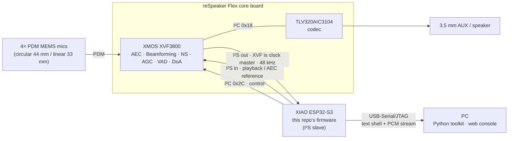

<div align="center">

# reSpeaker Flex XVF3800 — EVK Bring-up Toolkit

**From an unknown dev board to a working voice front-end: firmware, host tools and a live web console for the XMOS XVF3800 4-mic array.**


**English** | [繁體中文](README.zh-TW.md)


</div>

---

## What this is

The [Seeed reSpeaker Flex](https://wiki.seeedstudio.com/respeaker_flex_introduction/) pairs an **XMOS XVF3800** voice processor (AEC, beamforming, noise suppression, AGC, VAD, DoA) with a **XIAO ESP32-S3** host. Out of the box it does nothing visible on a PC — the audio goes over I2S to the ESP32, and the vendor material for that path is incomplete and, on one critical point, wrong.

This repository is the complete bring-up of that kit:

- **ESP32-S3 firmware** — a line-based control shell that drives the XVF3800 over I2C, captures its processed audio over I2S, and streams PCM to the PC loss-free.
- **Host toolkit (Python)** — name-based access to all **121 XVF3800 control parameters**, WAV recording, a scripted smoke test, DSP health monitoring and a beamforming A/B test.
- **Live web console** — levels, beam/DoA compass, DSP telemetry, one-click recording with playback, interactive beam steering and a searchable parameter editor. Zero third-party dependencies.
- **An engineering log** — every bring-up stage is a tracked experiment (`logs/R0XX`) with hypothesis, action, observation and conclusion.

## Highlights

| | |
|---|---|
| 🔍 **Root-caused a silent failure the vendor docs cause** | Following Seeed's documentation (ESP32 as I2S master) yields full-scale garbage. A purpose-built `clkprobe` command proved the XVF3800 image drives BCLK/WS itself at 48 kHz; switching the ESP32 to slave turned −6 dBFS noise into clean −48 dBFS room audio. [→ R003](logs/R003_i2s_role_xvf_is_master.md) |
| 📈 **Evidence, not guesses** | Audio validity checked by spectral analysis (64 dB low/high band ratio, flatness 0.000 vs 0.56 for white noise), clock roles by edge counting, streaming integrity by exact byte accounting (`padded=0`). |
| 🧩 **Full parameter surface** | The 121-entry XVF3800 command table is parsed from the vendor tool at runtime, so CLI, GUI and scripts stay in sync with the firmware release — no hand-copied register maps. |
| 🎛️ **Live DSP visibility** | Thread headroom, AGC gain, per-beam speech energy, auto-select / free-running / fixed beam azimuths and DoA, refreshed several times per second. |
| 🛡️ **Reversible by design** | Full 8 MB flash backup/restore scripts, runtime-only parameter changes (never saved unless you ask), and a git history scrubbed of any recordings. |

## Capabilities

| Capability | Status |
|---|---|
| Processed audio capture to WAV — 48 kHz, stereo, 16/32-bit, loss-free over USB | ✅ **Verified** |
| XVF3800 control — read/write all 121 parameters by name over I2C | ✅ **Verified** |
| Live DSP telemetry — AGC, VAD, DoA, beam azimuths, thread headroom | ✅ **Verified** |
| Beamforming — auto-select, free-running scan, steerable fixed beams, output routing | ✅ **Implemented** · live steering in GUI; directivity measurement tooling included (`beam_test.py`) |
| Acoustic echo cancellation, noise suppression, AGC, de-reverberation | ✅ **Implemented** · running on the XVF3800, tunable from the toolkit; quantitative AEC benchmark next |
| Playback / AEC reference path (ESP32 → XVF3800 → AIC3104 → AUX) | ✅ **Implemented** · `tone` command; speaker-loop validation next |
| Web console | ✅ **Verified** |
| Standalone Wi-Fi streaming | 🗺️ Roadmap |

> **Verified** = measured on hardware, numbers in `logs/`. **Implemented** = running and controllable end-to-end; the quantitative benchmark is the next milestone.

---

## Architecture



| Layer | Path | Role |
|---|---|---|
| Firmware | [`firmware/xiao_esp32s3`](firmware/xiao_esp32s3) | I2S full-duplex link (slave by default), XVF3800 I2C control with busy-retry, command shell, binary PCM streaming |
| Host library | [`host/evk`](host/evk) | Serial protocol, COM auto-detection, XVF parameter table + typed encode/decode |
| Tools | [`host/*.py`](host) | CLI, recorder, smoke test, DSP monitor, beam A/B, web console |
| Docs & evidence | [`docs/`](docs), [`logs/`](logs) | Hardware reference with sources, bring-up plan with pass criteria, experiment logs |

---

## Quick start

**You need:** a reSpeaker Flex XVF3800 *with* XIAO ESP32-S3 (SKU `-C4-1` / `-L4-1`), a USB-C data cable, Windows 10/11, Python 3.10+, Git and [PlatformIO](https://platformio.org/install).

> Plug the cable into the **XIAO's** USB-C (it enumerates as `303A:1001`), not the core board's port.

```powershell
git clone https://github.com/ElroyChenWI/respeaker-flex-bringup.git
cd respeaker-flex-bringup

.\scripts\fetch_vendor.ps1                       # Seeed command table + XMOS images (pinned commit)
python -m pip install -r host\requirements.txt
python host\env_check.py                         # -> B0 PASS

.\scripts\backup_xiao_flash.ps1                  # optional: 8 MB backup of the current ESP32 firmware
.\scripts\pio.ps1 run -t upload                  # build + flash (port auto-detected)

python host\evk_cli.py smoke                     # end-to-end self test
python host\evk_gui.py                           # web console -> http://127.0.0.1:8765
```

Expected smoke test:

```
[PASS] B1 shell: OK info i2s=off rate=0 role=slave
[PASS] B2 i2c scan: # 0x18 aic3104 | # 0x2C xvf3800 | OK i2cscan found=2
[PASS] B2 xvf version: OK ver 1.0.0
[PASS] B3 xvf drives clocks: OK clkprobe ... ws_hz~48000 ...
[PASS] B3 i2s start (slave): OK i2s started rate=48000 role=slave
[PASS] B3 i2s level: OK stat frames=48000 L_rms_dbfs=-48.0 ...
SMOKE PASS
```

All tools auto-detect the XIAO's COM port; override with `--port COMx` or `EVK_PORT=COMx`. Only one program can hold the port at a time.

---

## Toolkit

### Web console — `host/evk_gui.py`

| Panel | What it shows / does |
|---|---|
| Levels | Live L/R RMS + peak (dBFS) and a 20 s history trace |
| Beam / DoA compass | Mic geometry, auto-select beam, free-running scan beam, fixed beams and DoA (lit when speech is detected) |
| DSP telemetry | AGC gain, AEC convergence, AEC/PP thread headroom (current and minimum), per-beam speech energy |
| Recording | One-click capture, in-page playback, waveform, recent takes |
| Beamforming control | Output-routing presets (processed / raw mics / fixed beams → L/R) and a live azimuth slider |
| Parameters | All 121 XVF3800 parameters: search, read, write (with confirmation for reboot/flash-writing commands) |

Built on the Python standard library (`http.server` + one poller thread owning the serial link) and a single self-contained HTML page — nothing to install beyond the toolkit's own requirements.

### Command line

```powershell
python host\evk_cli.py list AGC                  # browse parameters
python host\evk_cli.py get AEC_AZIMUTH_VALUES    # read by name
python host\evk_cli.py set LED_EFFECT 3          # write by name (runtime only)
python host\evk_cli.py dsp --watch               # DSP health line, live
python host\evk_cli.py doa --watch               # direction of arrival, live
python host\record_wav.py --sec 10 --bits 32     # capture to captures\rec_<time>.wav
python host\beam_test.py                         # beam toward vs away A/B, L/R swap-corrected
```

### Firmware shell

Every command ends with exactly one `OK …` / `ERR …` line, so it is equally usable by hand (`.\scripts\pio.ps1 device monitor`) and by scripts.

| Command | Purpose |
|---|---|
| `info` · `i2cscan` · `ver` · `doa` | Board info, bus scan, XVF version, direction of arrival |
| `xr <resid> <cmd> <n>` · `xw <resid> <cmd> <bytes…>` | Raw XVF3800 control read / write |
| `i2s start [rate] [master\|slave]` · `i2s stop` | I2S link control (default `48000 slave`) |
| `clkprobe` | Detects externally driven BCLK/WS — tells you who the clock master is |
| `stat [ms]` | Per-channel RMS / peak / non-zero count |
| `rec <ms> [16\|32]` | Binary PCM stream: `REC rate=… ch=2 bits=… bytes=N` + N bytes + `OK rec frames=… padded=…` |
| `tone <hz> <ms> [dbfs]` | Sine to the XVF3800 I2S input (playback / AEC reference) |

Pin map, I2C protocol, USB ports and the XMOS image catalogue: [`docs/hardware.md`](docs/hardware.md).

---

## Engineering process

The bring-up was run as a sequence of gated stages — one change at a time, a baseline before every change, A/B evidence for every conclusion, and revert on failure.

| Stage | Result | Log |
|---|---|---|
| B0 Environment & USB baseline | ✅ | [R001](logs/R001_evk_usb_baseline.md) |
| B0.5 Full-flash backup | ✅ | [R002](logs/R002_xiao_flash_backup.md) |
| B1 Shell · B2 I2C control · B3 I2S capture | ✅ — XVF3800 is the I2S clock master; ESP32 runs as slave at 48 kHz | [R003](logs/R003_i2s_role_xvf_is_master.md) |
| B4 Recording to WAV | ✅ — loss-free stream, speech confirmed | [R003](logs/R003_i2s_role_xvf_is_master.md) |
| DSP health | ✅ — no bypass, ample thread headroom, beamformer / AGC / VAD / DoA live | [R004](logs/R004_xvf_dsp_health.md) |
| B5 AEC benchmark with speaker loop | ⏭️ next | |
| B6 DoA accuracy & beam directivity numbers | ⏭️ next (tooling ready) | |
| B7 USB UAC2 mode / 6-channel raw mics | ⏭️ optional | |

Full stage definitions and pass criteria: [`docs/bringup_plan.md`](docs/bringup_plan.md).

## Repository layout

```
firmware/xiao_esp32s3/   ESP32-S3 firmware (PlatformIO, Arduino core)
host/                    Python toolkit, web console (host/gui/), library (host/evk/)
scripts/                 Build/flash wrapper, flash backup & restore, vendor fetch
docs/                    Hardware reference, bring-up plan, screenshots
logs/                    R0XX experiment logs
captures/                Local recordings & backups (git-ignored)
third_party/             Seeed reSpeaker_Flex, fetched at a pinned commit (git-ignored)
```

## Troubleshooting

| Symptom | Fix |
|---|---|
| `303A:1001` not found | Use the **XIAO** USB-C and a data-capable cable |
| Full-scale noise (≈ −6 dBFS RMS) | ESP32 is configured as I2S master and fights the XVF clocks — use `i2s start 48000 slave` (the default) |
| `stat` reports no samples | Run `clkprobe`; if `ws_hz` is not ~48000, press the core board's RST to restart the XVF3800 |
| `could not open port` | Another program (GUI, serial monitor, Arduino IDE) holds the COM port |
| Wrong pitch / speed | In slave mode the XVF image sets the rate (`inthost-lr48` → 48 kHz); pass `--rate 16000` for a 16 kHz image |
| `third_party/... missing` | Run `.\scripts\fetch_vendor.ps1` |

## References

- Seeed Wiki — [reSpeaker Flex](https://wiki.seeedstudio.com/respeaker_flex_introduction/) · [with XIAO ESP32S3](https://wiki.seeedstudio.com/respeaker_flex_xiao_introduction/)
- [respeaker/reSpeaker_Flex](https://github.com/respeaker/reSpeaker_Flex) — XMOS firmware images and `xvf_host.py`
- XMOS — [XVF3800 host application & output selection](https://www.xmos.com/documentation/XM-014888-PC/html/modules/fwk_xvf/doc/user_guide/03_using_the_host_application.html#output-selection)
